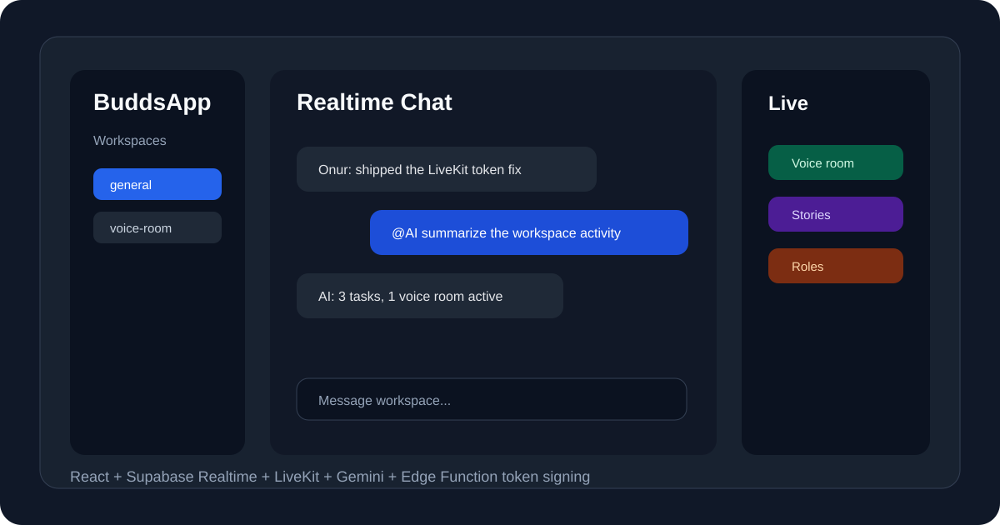

# BuddsApp

Real-time community chat platform with workspaces, voice rooms, stories, roles, file sharing, and an AI companion.



BuddsApp is a full-product React application built on Supabase, LiveKit, and Gemini. It is designed like a lightweight Discord-style workspace where users can join communities, chat in real time, share files, start voice calls, and interact with an AI assistant.

## Product Surface

- Workspace-based community structure
- Supabase Auth and member profiles
- Real-time chat through Supabase Realtime
- LiveKit-powered voice rooms
- Story-style media sharing
- Role-based controls for admins/moderators/members
- File sharing and document previews
- Gemini-backed AI companion behavior
- PWA-ready Vite build

## Architecture

| Area | Implementation |
| --- | --- |
| Frontend | React, Vite, custom CSS, Lucide icons |
| Auth and data | Supabase Auth, PostgreSQL, Realtime, Storage |
| Voice | LiveKit Cloud |
| AI | Supabase Edge Function secret |
| Server-side secret handling | Supabase Edge Functions |

## Security Note

LiveKit token signing and AI chat proxying are handled by Supabase Edge Functions (`livekit-token` and `ai-chat`). Neither the LiveKit API secret nor the Gemini API key is exposed in browser code; both must be configured as Supabase Edge Function secrets.

## Environment

Frontend `.env`:

```env
VITE_SUPABASE_URL=your_supabase_project_url
VITE_SUPABASE_ANON_KEY=your_supabase_anon_key
VITE_LIVEKIT_URL=wss://your-project.livekit.cloud
```

Supabase secrets:

```bash
supabase secrets set LIVEKIT_API_KEY=your_livekit_api_key
supabase secrets set LIVEKIT_API_SECRET=your_livekit_api_secret
supabase secrets set GEMINI_API_KEY=your_gemini_api_key
# Opsiyonel: Varsayılan model (gemini-3.5-flash) dışında bir model belirtmek için:
supabase secrets set GEMINI_MODEL=gemini-3.5-flash
```

## Demo Verisiyle Çalıştırma

Projeyi yerel ortamda veya test veritabanında hazır demo verileriyle çalıştırmak için:

1. **Supabase Auth Kullanıcısı Oluşturun:**
   - Supabase Dashboard -> **Authentication** -> **Users** sekmesinden `demo1@example.com` adresiyle bir kullanıcı oluşturun.
   - Oluşturulan kullanıcının `User UID` değerini kopyalayıp `supabase/seed.sql` dosyasında `Demo User 1` için `id` alanına yazın.
2. **Migration Dosyasını Uygulayın:**
   - Supabase SQL Editöründe `supabase/migrations/0001_rls_policies.sql` dosyasını çalıştırın.
3. **Demo Verilerini İçeri Aktarın:**
   - Supabase SQL Editöründe `supabase/seed.sql` dosyasını çalıştırın.
4. Bu işlem şunları oluşturur:
   - **Demo Workspace** çalışma alanı (`00000000-0000-0000-0000-000000000001`)
   - 5 sahte kullanıcı profili (`Demo User 1` - `Demo User 5`)
   - `00000000-0000-0000-0000-0000000000b1` geçerli demo davet kodu
   - "Genel Sohbet" kanalında 24 adet örnek sohbet mesajı

## Local Development

```bash
npm install
npm run dev
```

## Validation

```bash
npm run lint
npm run build
```

`npm run lint` currently passes with warnings that are useful cleanup candidates.

## Recent Hardening

- Removed LiveKit API secret usage from browser code
- Added Supabase Edge Function token signing
- Proxied Gemini requests through Supabase Edge Function with input payload limits
- Migrated authorization to database role checks and PostgreSQL RLS policies
- Secured invite system via `redeem_invite` security definer RPC
- Removed generated build and scratch artifacts from source control
- Updated environment guidance to avoid leaking voice and AI infrastructure secrets

## Roadmap

- Add real screenshots from a seeded workspace
- Split large chat-room logic into smaller modules
- Add focused integration tests for invite and voice-call flows
- Add deployment notes for Supabase/Vercel setup

## Author

Onur Acar - <https://github.com/onuracar-dev>
